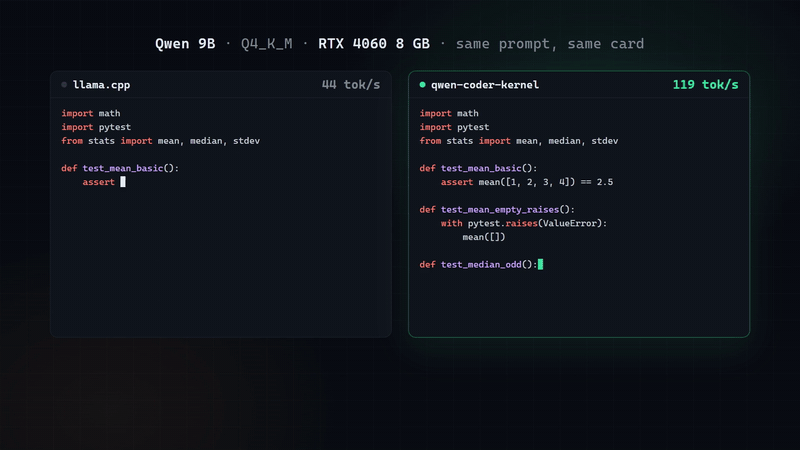
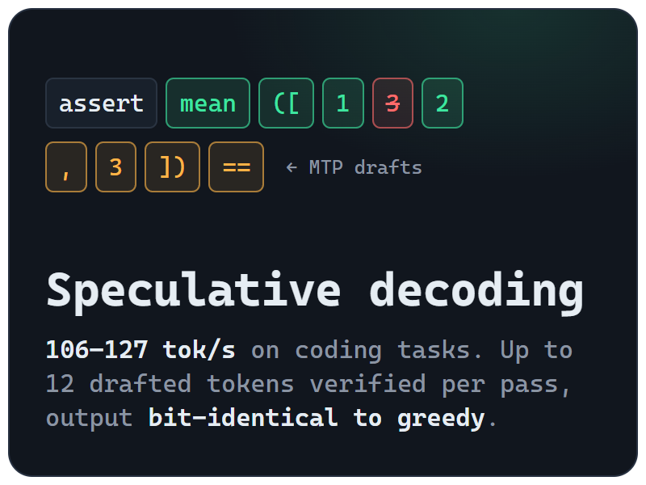
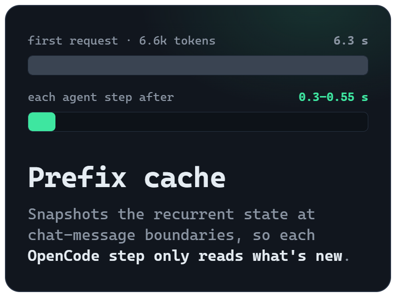
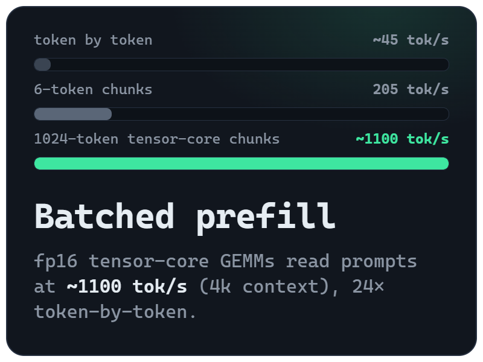
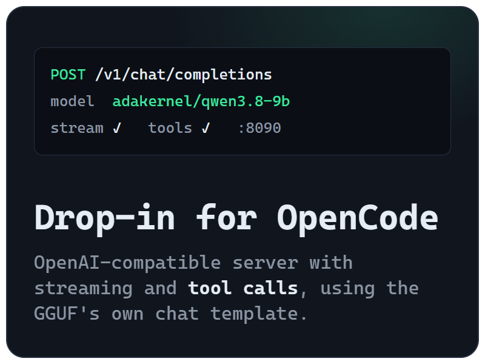
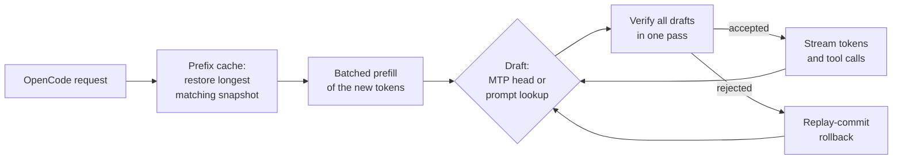

<a id="readme-top"></a>

<p align="center">
  
</p>

<p align="center">
  <b>A custom CUDA kernel that runs Qwen faster in OpenCode.</b><br>
  100-350 tok/s decoding coding tasks on an 8 GB RTX 4060 (llama.cpp: 44), with output bit-identical to greedy decoding.
</p>

<p align="center">
  <a href="#build"></a>
  <a href="pyproject.toml"></a>
  <a href="#build"></a>
</p>

<p align="center">
  <a href="#demo">Demo</a> · <a href="#quickstart">Quickstart</a> · <a href="#numbers">Numbers</a> · <a href="#how-it-works">How it works</a> · <a href="docs/QWEN38_9B.md">Full write-up</a>
</p>

## Demo

<p align="center">
  <a href=".github/readme/brag.mp4"></a>
  <!-- Playable video: drag .github/readme/brag.mp4 into the GitHub README editor and paste the user-attachments URL here. -->
</p>

<p align="center"><sub>Same model, same card, same coding prompt. <a href=".github/readme/brag.mp4">Watch the 20-second video</a>.</sub></p>


## Why

A CUDA runtime for **Qwen3.8 9B** (`eriktonon/qwen3.8-uncensored:9b` from Ollama), tuned for coding on an 8 GB
RTX 4060, with an OpenAI-compatible server so OpenCode (or Continue, Aider, ...) can use it as a local provider.

> [!NOTE]
> **Why the code says "qwen35".** Qwen3.8 9B is a fine-tune of Qwen3.5-9B, so it keeps that model's layout: Gated
> DeltaNet layers with gated attention every fourth layer, plus the MTP head. Its GGUF file labels that layout
> `qwen35`, and the runtime is named after it (`qwen35_model.cu`, `Qwen35Model`). The name means the layout, not the
> model version. The stock `qwen3.5:9b` from Ollama is not what this repo was built or measured on.

```powershell
powershell -ExecutionPolicy Bypass -File scripts\serve.ps1   # http://127.0.0.1:8090/v1
# OpenCode → adakernel/qwen3.8-9b
#   100-350 tok/s on coding tasks · agent follow-up steps start in 0.05-0.4 s
```

## Features

<p align="center">
  
  
</p>
<p align="center">
  
  
</p>

- **Decode:** dp4a GEMVs on Q4_K / Q6_K / Q8_0 weights, CUDA graphs, fused ops: 46 tok/s plain greedy (llama.cpp: 44).
- **Speculative decoding:** MTP-head drafts and prompt-lookup drafts, chosen per round from measured costs, verified up
  to 12 tokens per pass, with acceptance tracked by n-gram match length. Output is bit-identical to greedy. 100-350
  tok/s on coding tasks (the high end when the answer copies code from the prompt).
- **Rollback:** replay-commit for the recurrent state, so rejected drafts cost no state copies.
- **Batched prefill:** int8 tensor-core GEMMs (fused FFN gate / up / SiLU, split-K for short chunks), tensor-core
  FlashAttention-style attention and a shuffle-light delta-rule kernel: a 6k-token prompt from cold in ~3.3 s.
- **Prefix cache:** recurrent-state snapshots at chat-message boundaries, taken inside the prefill pass, so each agent
  step only processes what is new (0.05-0.4 s for 20-750 new tokens instead of re-reading 7k-24k tokens).
- **Server:** `adakernel/serve.py`, OpenAI chat completions with streaming and tool calls, rendered with the GGUF's own
  chat template.

## Numbers

Current build, RTX 4060 8 GB, model `eriktonon/qwen3.8-uncensored:9b` (Q4_K_M). Decode speed of speculative decoding
on six coding chat requests over this repo's own source (`benchmarks/decode_bench.py`, 256 tokens each; output is
exactly the greedy tokens). llama.cpp's plain greedy decode on this card is 44 tok/s.

| Task (prompt tokens) | decode |
|---|---:|
| refactor a function (1138) | **352 tok/s** |
| add comments, return the code (1073) | **206 tok/s** |
| implement from a description (86) | 116 tok/s |
| translate to Python (984) | 111 tok/s |
| explain code (1680) | 109 tok/s |
| write tests (2368) | 100 tok/s |

Agent-style session replay (`benchmarks/chunk_profile.py`, 40k context): the first request with a 6k-token prompt
takes ~3.3 s; follow-up requests that add 50 / 148 / 375 / 748 / 1446 tokens take 0.05 / 0.13 / 0.21 / 0.41 / 0.88 s.

Where it stands: decode of MTP-drafted output is within ~10% of the card's memory-bandwidth limit, and prompt
reading is ~87% int8 tensor-core GEMMs at about a third of their peak. The current-state summary, every
optimization with its measurements and reasoning, and what is left are in [docs/QWEN38_9B.md](docs/QWEN38_9B.md).

Earlier end-to-end comparison against llama.cpp (three chat requests from the original benchmark, 256 generated
tokens each, before the optimizations in docs/QWEN38_9B.md after "Tensor-core attention"):

| Task (prompt tokens) | llama.cpp | this kernel, greedy | **this kernel, spec** |
|---|---:|---:|---:|
| write tests (1799) | 6.62 s, 44 tok/s | 7.17 s, 46 tok/s | **3.90 s, 119 tok/s** |
| refactor (740) | 6.10 s, 44 tok/s | 6.24 s, 46 tok/s | **2.74 s, 127 tok/s** |
| explain (948) | 6.20 s, 44 tok/s | 6.33 s, 46 tok/s | **3.27 s, 106 tok/s** |

In a real OpenCode session ("fix two bugs in stats.py, run it"), the 6.6k-token system prompt was read once in 6.3 s;
each of the following steps started in 0.3-0.55 s and decoded at 82-100 tok/s, for 13.6 s end to end.

Methodology, per-kernel profiles, long-context numbers and next steps are in [docs/QWEN38_9B.md](docs/QWEN38_9B.md).


## Quickstart

### Build

Needs CUDA 12.8+ (for sm_89), VS 2022 Build Tools, CMake 3.24+ and Ninja.

```powershell
powershell -ExecutionPolicy Bypass -File scripts\build.ps1 -Cuda <cuda toolkit root>
```

The script records the toolkit's `bin` folder in `build/cuda_bin.txt`, and the Python loader uses it to find cudart and
cuBLAS. Python needs `numpy` and `jinja2`; the tests also need `pytest`.

### Get the model

```powershell
ollama pull eriktonon/qwen3.8-uncensored:9b
```

The server reads the weights straight from Ollama's store
(`~/.ollama/models/blobs/sha256-c7f6915f…3408`, 5.78 GB, Q4_K_M), so Ollama itself does not need to be running.

### Run with OpenCode

```powershell
powershell -ExecutionPolicy Bypass -File scripts\serve.ps1            # -Ctx 40960 -PfCols 512 -Port 8090 -Model <gguf>
```

Then pick `adakernel/qwen3.8-9b` in OpenCode. To load a different GGUF with the same `qwen35` layout, pass its path
with `-Model` (only Qwen3.8 9B has been tested).

<details>
<summary>OpenCode provider entry (<code>~/.config/opencode/opencode.json</code>)</summary>

```json
{
  "$schema": "https://opencode.ai/config.json",
  "providers": {
    "adakernel": {
      "name": "AdaKernel (local)",
      "package": "@opencode/ai/providers/openai-compatible",
      "settings": { "baseURL": "http://127.0.0.1:8090/v1" },
      "models": {
        "qwen3.8-9b": {
          "modelID": "qwen3.8-9b",
          "name": "Qwen3.8 9B (AdaKernel)",
          "capabilities": { "tools": true, "input": ["text"], "output": ["text"] },
          "limit": { "context": 40960, "output": 4096 }
        }
      }
    }
  }
}
```

The server uses port 8090 because OpenCode auto-discovers :8000 as vLLM with tools off.

</details>

> [!NOTE]
> One request at a time, greedy decoding only (temperature is ignored), 40k context by default (peaks at ~7.7 GB on an 8 GB card;
> `-Ctx 32768 -PfCols 1024` leaves more room for other apps).

### Tests

```powershell
python -m pytest tests -q
```

`tests/test_serve.py` runs on the CPU. `tests/test_qwen35.py` loads the model on the GPU (~6 GB). Set `LLAMA_CPP_BIN`
to a llama.cpp `build/bin` folder to also check token and greedy-output parity with llama.cpp.

### Benchmarks

| Command | What it measures |
|---|---|
| `python -m benchmarks.decode_bench` | speculative decode tok/s on six coding prompts, plus a logits hash for bit-exactness checks across builds |
| `python -m benchmarks.chunk_profile` | GPU time per prefill chunk by kernel group, and an agent-session replay (first turn + follow-ups) |
| `python -m benchmarks.long_context` | prompt reading and decode at 4k-36k context |
| `python -m benchmarks.llama_match` | how long greedy output agrees with `llama-completion --temp 0` |
| `scripts\cuda_bench.ps1 -Bench attn` / `-Bench gemm` | attention or int8 GEMM kernels alone on random data (no model load): bit equality and timing |
| `scriptsb_profile.ps1 -A <checkout> -B <checkout>` | interleaved A/B of `chunk_profile` between two builds |
| `python -m benchmarks.sass_hotspots <sass.csv>` | summarizes an Nsight Compute SASS export (stalls by opcode, bank conflicts) |

The model benchmarks load the model on the GPU (~6 GB), so stop the server first or wait for it to be idle.

## How it works



Each round drafts tokens, then the target model verifies all of them in one multi-column pass, so its 4.9 GB of
weights are read once per round instead of once per token. Rejected drafts resume from the last accepted column.
Prompts are rendered with the GGUF's own Jinja chat template, and Qwen's `<tool_call>` XML is converted to OpenAI
`tool_calls`.

## Origin

Built and measured against `eriktonon/qwen3.8-uncensored:9b` (Q4_K_M, from Ollama). Split out of the `kernel-sanders`
experiments repo (branch `qwen35-gdn`), where the benchmark scripts and llama.cpp comparisons live.

<p align="right"><a href="#readme-top">↑ back to top</a></p>

<p align="center">
  
</p>
